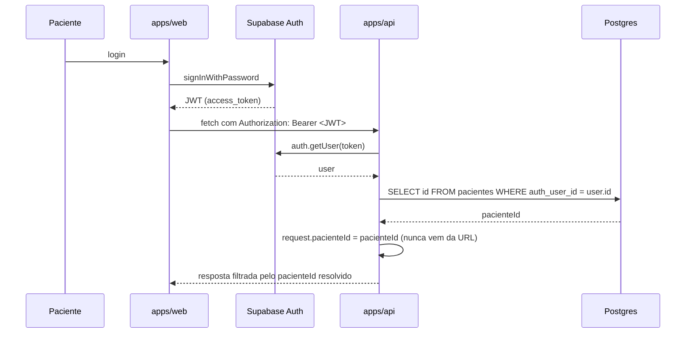
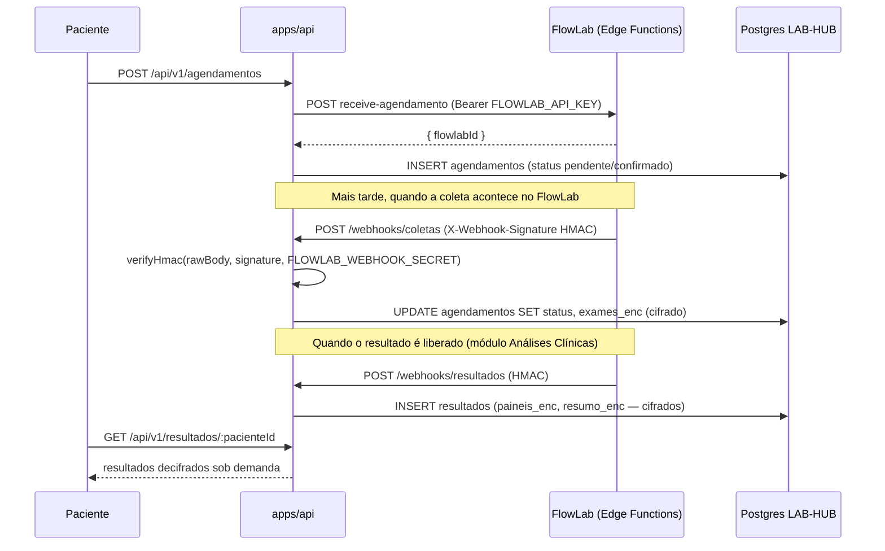

# Architecture — LAB-HUB

> Última atualização: 2026-09-17

## Visão Geral

LAB-HUB é o **portal do paciente** de um laboratório de análises clínicas: agendamento de coleta, acompanhamento de status da coleta, visualização/download de laudos, upload de documentos (pedido médico, identidade) e gestão de cadastro. É o par complementar do **FlowLab**, que é o sistema operacional interno do laboratório (recepção, coleta, análise, faturamento) — a divisão de responsabilidade é explícita e documentada (`docs/ARQUITETURA_ANALISES_CLINICAS.md`): "nenhuma tela operacional de laboratório vive no LAB-HUB; o LAB-HUB é um portal do paciente, o FlowLab executa o laboratório".

É um monorepo com três apps — `apps/web` (portal web, React), `apps/mobile` (app React Native/Expo, hoje um protótipo com dados mockados, sem integração real) e `apps/api` (backend Fastify) — mais um pacote `packages/shared` de tipos de domínio compartilhados entre os três. O backend fala com dois mundos diferentes ao mesmo tempo: o **FlowLab** (via Edge Functions server-to-server e webhooks HMAC, para agendamento e para o resultado estruturado do novo módulo de Análises Clínicas) e os **LIS do laboratório de apoio** diretamente — Álvaro Online (AOL, XML/SOAP) e APLIS (REST/JSON) — para os laudos "tradicionais", que hoje ainda são a fonte principal de resultado exibida ao paciente.

O dado tratado é **saúde + identidade** (laudos clínicos, CPF, documentos de identidade) — dado pessoal sensível pela LGPD. Isso molda quase todas as decisões arquiteturais do projeto: criptografia de coluna com chave fora do banco, índice cego para CPF, trilha de auditoria de acesso, política de retenção/expurgo, RLS travado a ponto de o `anon`/`authenticated` não terem privilégio nenhum no schema (a API, com `service_role`, é o único caminho de escrita/leitura). Há uma auditoria de segurança formal e contínua (`docs/AUDITORIA_SEGURANCA.md`) que documenta cada achado, correção e decisão de risco aceito.

## Stack Tecnológica

| Categoria | Tecnologia | Versão | Observação |
|---|---|---|---|
| Linguagem | TypeScript | ^5.5 | Monorepo via npm workspaces (`apps/*`, `packages/*`) |
| API | Fastify | ^5.3 | `apps/api` — `@fastify/helmet`, `@fastify/cors`, `@fastify/rate-limit`, `@fastify/multipart`, `@fastify/sensible` |
| Validação | Zod | ^3.25 | Schemas de request/webhook em `apps/api/src/schemas/` |
| Log | Pino | ^10.3 | Logger nativo do Fastify, com redação de PII (`CAMPOS_REDIGIDOS`) |
| Web | React | 19.1 | `apps/web`, build com Vite ^6.0 |
| Mobile | React Native (Expo) | 0.81 / Expo ^56 | `apps/mobile` — NativeWind (Tailwind), protótipo parado (mocks) |
| Backend-as-a-Service | Supabase | JS SDK ^2.108 | Postgres + Auth + Storage; API usa `service_role`, web/mobile usam chave pública sob RLS |
| Parsing XML | fast-xml-parser | ^5.10 | Integração SOAP/XML com o LIS Álvaro Online (AOL) |
| Testes | vitest | ^3.2 | `apps/api` (195+ testes) e `apps/web` (52+ testes) |
| CI | GitHub Actions | — | type-check, lint, testes, build, `npm audit` — por workspace, `apps/mobile` excluído |
| Deploy | Docker (multi-stage) + ngrok | Node 22-alpine | Deploy manual em VPS via `docker compose up -d --build`, sem CD automatizado |
| Criptografia | Node `crypto` nativo (AES-256-GCM + HMAC-SHA256) | — | Coluna cifrada + índice cego de CPF, ver Decisões Arquiteturais |

## Estrutura de Diretórios

```
LAB-HUB/
├── apps/
│   ├── api/                          # Backend Fastify — único caminho de escrita/leitura no Supabase
│   │   ├── src/
│   │   │   ├── server.ts             # Bootstrap: helmet, cors, rate-limit, registro de rotas, /ping
│   │   │   ├── routes/                # cadastro, pacientes, agendamentos, postos, resultados, laudos,
│   │   │   │                          # documentos, integracao, webhooks, admin
│   │   │   ├── schemas/               # Validação zod por rota/webhook
│   │   │   ├── middlewares/           # auth.ts (JWT Supabase → pacienteId), adminAuth.ts, apiKey.ts
│   │   │   ├── laudos/                 # Motor de busca/consolidação de laudos nos LIS externos
│   │   │   │   ├── aol.ts              # Cliente SOAP/XML do Álvaro Online
│   │   │   │   ├── aplis.ts            # Cliente REST/JSON do APLIS
│   │   │   │   ├── service.ts, repository.ts, mappers.ts, identidade.ts
│   │   │   │   └── strategies/         # Estratégias de mapeamento por tipo de exame
│   │   │   ├── lib/
│   │   │   │   ├── crypto.ts           # Criptografia de coluna (AES-256-GCM, envelope versionado)
│   │   │   │   ├── cpf.ts              # Validação + índice cego (HMAC-SHA256) de CPF
│   │   │   │   ├── hmac.ts             # Verificação de assinatura dos webhooks do FlowLab
│   │   │   │   ├── flowlab.ts          # Cliente das Edge Functions do FlowLab (agendamento/disponibilidade)
│   │   │   │   ├── auditoria.ts        # Trilha de acesso a dado de saúde (LGPD art. 37/38)
│   │   │   │   ├── expurgo.ts, apagarPaciente.ts  # Retenção e exclusão de conta/documentos
│   │   │   │   └── supabase.ts, env.ts, http.ts
│   │   │   └── scripts/                # expurgo, apagar-paciente, backfill-cripto (rodáveis via npm run)
│   │   └── test/                       # 195+ testes — cobre identidade, criptografia, auditoria, webhooks
│   │
│   ├── web/                            # Portal do paciente (Vite + React 19)
│   │   └── src/
│   │       ├── pages/                  # Login, Cadastro, Home, Schedule, Results, ExamDetail, Laudo,
│   │       │                           # Documents, Profile, Settings, Billing, Trends
│   │       ├── components/             # auth/, schedule/, documents/, laudo/, layout/, primitives/, shared/
│   │       └── lib/                     # api.ts (fetch p/ apps/api + JWT), supabase.ts, AuthContext.tsx,
│   │                                    # useAgendamentos/useDocumentos/usePaciente/useResultados
│   │
│   └── mobile/                          # Expo/React Native — protótipo com mocks, sem integração real (CI o exclui)
│       └── src/{components,screens,mocks}/
│
├── packages/shared/                     # Pacote type-only: tipos de domínio (Agendamento, payloads
│   └── src/index.ts                     # FlowLab, correção de identidade) compartilhados por web/mobile/api
│
├── supabase/migrations/                 # ~25 migrations — schema + trava de RLS + criptografia + auditoria
├── docs/
│   ├── AUDITORIA_SEGURANCA.md           # Auditoria de segurança viva — achados, correções, riscos aceitos
│   ├── ARQUITETURA_ANALISES_CLINICAS.md # Plano de integração LAB-HUB ↔ FlowLab (módulo Análises Clínicas)
│   ├── LAUDOS_LIS.md, FLUXO.md, ANALISES_CLINICAS.md
│   └── agents/                          # Docs para agentes (issue tracker, domínio)
├── .scratch/                            # Issues/specs locais em markdown (padrão do issue tracker do time)
├── Dockerfile                            # Multi-stage: só apps/api (web é servido separadamente)
├── docker-compose.yml                    # api + túnel ngrok, deploy manual em VPS
└── .github/workflows/ci.yml
```

## Arquitetura do Sistema

```mermaid
flowchart TB
    subgraph Client["Cliente"]
        Web["apps/web (React 19 + Vite)"]
        Mobile["apps/mobile (Expo — protótipo, mocks)"]
    end

    subgraph API["apps/api (Fastify :3333)"]
        Auth["middlewares/auth.ts<br/>JWT Supabase → pacienteId"]
        Routes["routes/*<br/>cadastro, agendamentos, resultados,<br/>laudos, documentos, webhooks, admin"]
        Laudos["laudos/*<br/>consolidação AOL + APLIS, cache TTL"]
        Crypto["lib/crypto.ts, lib/cpf.ts<br/>cifra coluna + índice cego"]
    end

    subgraph Supabase["Supabase LAB-HUB (Postgres)"]
        DB[("pacientes, agendamentos,<br/>resultados, correcoes_identidade,<br/>auditoria_acesso — RLS: só service_role")]
        AuthSB["Supabase Auth"]
        Storage["Storage (buckets privados,<br/>signed URL de TTL curto)"]
    end

    subgraph FlowLab["FlowLab (outro repositório)"]
        EdgeFn["Edge Functions<br/>receive-agendamento, receive-cancelamento,<br/>receive-documento, get-disponibilidade"]
        Webhooks["Webhooks → LAB-HUB<br/>/webhooks/resultados, /webhooks/coletas<br/>(HMAC-SHA256)"]
    end

    subgraph LIS["LIS do laboratório de apoio"]
        AOL["Álvaro Online (AOL)<br/>SOAP/XML"]
        APLIS["APLIS<br/>REST/JSON"]
    end

    Web -->|fetch + JWT| Routes
    Mobile -.mocks, sem integração real.-> Routes
    Routes --> Auth
    Routes --> DB
    Routes --> Storage
    Web -->|supabase-js, sob RLS (Auth apenas)| AuthSB

    Routes -->|server-to-server, Bearer FLOWLAB_API_KEY| EdgeFn
    Webhooks -->|HMAC-SHA256| Routes

    Laudos --> AOL
    Laudos --> APLIS
    Routes --> Laudos

    Routes --> Crypto
    Crypto --> DB
```

A API é o **único** ponto de contato com o Postgres: `anon`/`authenticated` não têm privilégio nenhum no schema `public` (revogado explicitamente, achado S-01 da auditoria) — o front-end usa Supabase só para **Auth** (login/sessão), nunca para consultar dados diretamente. Toda leitura/escrita de dado do paciente passa pela API com `service_role`, que resolve `pacienteId` a partir do JWT (nunca da URL, para evitar IDOR) e decide o que cada rota expõe.

## Fluxo de Dados

### Autenticação (todas as rotas de paciente)



### Agendamento (LAB-HUB → FlowLab) e resultado (FlowLab → LAB-HUB)



Os webhooks do FlowLab são **at-least-once**: a API trata reentrega como idempotente (colisão de unique constraint → 200 silencioso, mas logado) e distingue erro transitório (5xx, para o FlowLab retentar) de agendamento desconhecido (200 `ignored`, para não retentar para sempre um caso permanentemente impossível).

### Laudos — segunda fonte de resultado, independente do FlowLab

`GET /api/v1/laudos` não depende do webhook do FlowLab: consulta **diretamente** os LIS do laboratório de apoio (AOL e APLIS) usando o CPF do paciente autenticado (nunca vindo do cliente), consolida/deduplica por O.S., cacheia por `EXAM_CACHE_TTL_HOURS` (default 24h) e serve. A flag `LAUDOS_SOMENTE_ALVARO` decide se a listagem exige laudo com valor medido no Álvaro (padrão) ou também mostra requisições que só existem no APLIS. Isso significa que o LAB-HUB tem **dois pipelines de resultado paralelos e independentes**: o novo (webhook estruturado do módulo Análises Clínicas do FlowLab) e o legado/direto (consulta aos LIS), ainda hoje a fonte principal.

## Módulos e Responsabilidades

| Módulo | Local | Responsabilidade | Não faz |
|---|---|---|---|
| **Autenticação** | `middlewares/auth.ts` | Resolve `pacienteId` a partir do JWT Supabase, nunca da URL | Não faz RBAC — todo paciente autenticado só vê o próprio dado, por design de query |
| **Cadastro/Identidade** | `routes/cadastro.ts`, `laudos/identidade.ts`, `lib/apagarPaciente.ts` | Criação de conta, vínculo com paciente pré-existente por CPF+nascimento, correção de identidade auditável, exclusão de conta (LGPD) | Não permite reivindicar paciente-fantasma só por CPF (corrigido — precisa de segundo fator) |
| **Agendamento** | `routes/agendamentos.ts`, `lib/flowlab.ts` | Cria/lista/cancela agendamento; repassa ao FlowLab via Edge Function; cache curto de disponibilidade só para exibição | Nunca confia no cache para validar a criação — valida o slot ao vivo |
| **Laudos (LIS direto)** | `apps/api/src/laudos/` | Busca/consolida resultado direto no AOL e no APLIS, com cache e dedup | Não é o caminho do módulo novo de Análises Clínicas — é a fonte legada, ainda principal |
| **Resultados (webhook FlowLab)** | `routes/resultados.ts`, `routes/webhooks.ts` | Recebe resultado estruturado liberado pelo FlowLab (painéis, resumo) | Não substitui `laudos/` — convivem |
| **Documentos** | `routes/documentos.ts` | Upload validado por magic bytes, storage privado com signed URL de TTL curto | Não aceita tipo de arquivo por extensão/MIME declarado pelo cliente |
| **Criptografia de coluna** | `lib/crypto.ts`, `lib/cpf.ts` | AES-256-GCM com chave fora do banco + índice cego (HMAC) para CPF, envelope versionado (rotação de chave) | Não protege contra paciente autenticado vendo o próprio dado nem contra servidor comprometido — protege contra dump/backup/réplica |
| **Auditoria** | `lib/auditoria.ts` | Trilha append-only de acesso a dado de saúde (LGPD art. 37/38) | — |
| **Retenção/Expurgo** | `lib/expurgo.ts`, scripts `expurgo`/`backfill-cripto` | Apaga documento após prazo de finalidade; re-cifra em rotação de chave | Roda como script manual/cron, não automático no request path |
| **Admin** | `routes/admin.ts`, `middlewares/adminAuth.ts` | Consulta de resultado por CPF para suporte, com duplo gate (`ADMIN_EMAIL` + `ADMIN_RESULTS_ENABLED=true` exigido em produção) | Falha fechada por padrão — nenhuma env sozinha habilita em produção |
| **Portal web** | `apps/web/src/pages/` | Todas as telas do paciente (agendar, ver resultado, laudo, documentos, perfil) | Nunca consulta Postgres direto — só a API e o Supabase Auth |
| **Mobile** | `apps/mobile/` | Protótipo de portal mobile | Não está integrado a dados reais (mocks); excluído do CI |

## Integrações Externas

| Serviço | Propósito | Onde |
|---|---|---|
| **Supabase** | Postgres (via API, `service_role`), Auth (web/mobile), Storage (documentos, buckets privados) | `lib/supabase.ts` (api), `apps/web/src/lib/supabase.ts` |
| **FlowLab** (Edge Functions) | Agendamento, cancelamento, disponibilidade de postos, notificação de documento anexado | `lib/flowlab.ts` |
| **FlowLab** (webhooks recebidos) | Resultado liberado, mudança de status de coleta — HMAC-SHA256 | `routes/webhooks.ts` |
| **Álvaro Online (AOL)** | LIS do laboratório de apoio — SOAP/XML, fonte principal de laudo | `laudos/aol.ts` |
| **APLIS** | LIS do laboratório de apoio — REST/JSON, descoberta de requisição | `laudos/aplis.ts` |
| **APLIS (site interno)** | Leitura do anexo "Laudo EXTERNO" (PDF tipo 14) da requisição, de onde saem O.S. e CPF. Sem contrato do fornecedor; somente leitura. Usado pela busca de laudos e pelo download do laudo original (`GET /laudos/requisicoes/:codigoLis/original`, entregue ao vivo e nunca guardado) quando `LAUDOS_OS_VIA_PDF=true`, e pela auditoria `scripts/auditar-vinculos.ts --os-pdf` | `laudos/aplisSite.ts`, `laudos/laudoExterno.ts`, `laudos/vinculoPdf.ts`, `laudos/divergencia.ts` (PDF × `idOsLis`), `laudos/laudoOriginal.ts` |
| **Umami** | Analytics (web) | `VITE_UMAMI_*` |
| **ngrok** | Túnel público HTTPS para a API em VPS (webhook do FlowLab, frontend) | `docker-compose.yml` |

## Decisões Arquiteturais

### RLS travado a zero — a API é o único caminho de dado
- **Contexto**: auditoria de segurança (achado S-01, crítico) encontrou `anon`/`authenticated` com INSERT/UPDATE/DELETE/TRUNCATE em todas as tabelas via PostgREST — um paciente podia reescrever o próprio CPF e puxar laudo alheio.
- **Decisão**: revogados todos os privilégios de `anon`/`authenticated` (e do pseudo-role `PUBLIC`, que os dois herdam — não é coberto por um `revoke` direto) no schema `public`, com `alter default privileges` para que tabela nova não nasça aberta. Só o `service_role` (a API) lê/escreve.
- **Consequência**: o frontend usa Supabase exclusivamente para Auth; qualquer dado passa pela API. Reforça a arquitetura "API como único gatekeeper", mas significa que toda feature nova de dado precisa de uma rota — não dá para o web consultar uma tabela nova direto.

### Reivindicação de identidade por CPF + segundo fator, campos imutáveis pós-vínculo
- **Contexto**: achado P-01 (alto) — assumir um paciente pré-cadastrado (paciente-fantasma) só exigia saber o CPF.
- **Decisão**: `cpf`, `data_nascimento` e `auth_user_id` viram imutáveis via trigger depois que a conta é vinculada; correção de identidade passa a ser operação explícita, autorizada pela recepção do FlowLab, registrada em `correcoes_identidade` (trilha append-only que nem a API reescreve).
- **Consequência**: a tela de correção vive no FlowLab (outro repositório), consumindo o contrato `CorrigirIdentidadePayload`/`CorrigirIdentidadeResposta` de `packages/shared` — uma decisão de segurança do LAB-HUB acabou criando uma dependência funcional cruzada com o outro sistema.

### Criptografia de coluna com chave fora do banco, envelope versionado
- **Contexto**: dado clínico e identificadores em texto puro no Postgres (achado S-06, médio) — Supabase já cifra disco e trânsito, mas não protege contra dump, backup, réplica, staging populado com dado real ou acesso indevido ao Studio.
- **Decisão**: AES-256-GCM com a chave (`PII_KEY_K*`) só na env da API, nunca no Supabase; envelope autodescritivo (`v1:k1:<iv>:<tag>:<ciphertext>`) com `keyId` embutido para permitir rotação gradual (chave nova de escrita, antiga ainda decifra, backfill re-cifra em segundo plano); AAD amarrado a `tabela:coluna:id` para que ninguém com escrita no banco mova um valor cifrado para a linha de outro paciente sem detecção. CPF ganhou índice cego (HMAC-SHA256 determinístico) para permitir busca exata/unicidade sem guardar CPF em claro.
- **Consequência**: perder a chave é perder o dado (documentado explicitamente); a chave precisa de backup separado do backup do banco. A criptografia **não** resolve controle de acesso — um paciente autenticado recebe seu próprio dado decifrado normalmente, e quem compromete o servidor da API tem a chave. É proteção contra vazamento lógico, não contra ataque à aplicação.

### Dois pipelines de resultado paralelos (LIS direto vs. webhook FlowLab)
- **Contexto**: o portal já existia consultando AOL/APLIS diretamente antes do módulo Análises Clínicas do FlowLab existir; o novo módulo entrega resultado estruturado por webhook.
- **Decisão**: os dois caminhos convivem — `laudos/` (consulta direta aos LIS, com cache) continua sendo a fonte principal (`LAUDOS_SOMENTE_ALVARO`), enquanto `routes/resultados.ts`/`routes/webhooks.ts` atendem o fluxo novo.
- **Consequência**: dois modelos de dado e dois caminhos de exibição de resultado no mesmo portal; migrar definitivamente para o webhook exigiria decidir o que acontece com o histórico e a UX de quem já usa o caminho direto.

### Deploy manual em VPS, sem CD
- **Contexto**: `docker-compose.yml` documenta explicitamente "deploy manual — você mesmo sobe, sem CI": `git pull` + `docker compose up -d --build` no VPS.
- **Decisão**: CI (GitHub Actions) cobre type-check, lint, testes e `npm audit`, mas **não** publica nem faz deploy — isso é manual, e a ordem importa (a chave `PII_KEY_K1` precisa estar no `.env` do VPS *antes* do `docker compose up`, senão o container não sobe).
- **Consequência**: nenhum passo automatizado impede um deploy sem a chave de criptografia (o boot falha rápido e visivelmente, que é o efeito desejado, mas ainda depende de alguém acompanhar o log). Não há rollback automatizado — reverter é outro `git pull` + rebuild manual.

### `apps/mobile` como protótipo parado, fora do CI
- **Contexto**: comentário explícito no `ci.yml` — "`apps/mobile` (protótipo com mocks, parado) não compila hoje e derrubaria o CI por algo que ninguém está tocando".
- **Consequência**: o app mobile existe no monorepo e compartilha `packages/shared`, mas não tem paridade funcional com o web nem integração real com a API — quem avaliar "o que o LAB-HUB oferece" pelo mobile vai ver menos do que existe de fato no web.

## Configuração e Variáveis de Ambiente

| Grupo | Variáveis | Observação |
|---|---|---|
| Supabase (API) | `SUPABASE_URL`, `SUPABASE_SECRET_KEY` (novo, revogável) / `SUPABASE_SERVICE_ROLE_KEY` (legado) | Server-side, ignora RLS |
| Supabase (web) | `VITE_SUPABASE_URL`, `VITE_SUPABASE_PUBLISHABLE_KEY` / `VITE_SUPABASE_ANON_KEY` (legado) | Pública, sob RLS |
| Integração FlowLab | `FLOWLAB_EDGE_FUNCTION_URL`, `FLOWLAB_API_KEY`, `FLOWLAB_TIMEOUT_MS`, `FLOWLAB_DISPONIBILIDADE_TTL_MS`, `FLOWLAB_WEBHOOK_SECRET` | Chave e secret precisam bater com o `.env` do FlowLab |
| LIS (laudos) | `APLIS_BASE_URL`, `APLIS_USUARIO`, `APLIS_SENHA`, `APLIS_PERIODO_DIAS`, `AOL_BASE_URL`, `AOL_IDAGENTE`, `AOL_SENHA`, `AOL_ENTIDADE`, `EXAM_CACHE_TTL_HOURS`, `LAUDOS_SOMENTE_ALVARO` | |
| APLIS site interno (anexo Laudo EXTERNO) | `LAUDOS_OS_VIA_PDF`, `APLIS_WEB_URL`, `APLIS_WEB_USUARIO`, `APLIS_WEB_SENHA` | A flag é desligada por padrão. Credenciais opcionais: sem as três o caminho fica inerte. Usuário próprio e somente leitura |
| Criptografia | `PII_KEY_K1` (+`K2`... p/ rotação), `PII_CHAVE_ATUAL`, `CPF_HASH_KEY` | Obrigatórias em produção — boot falha sem elas (fail-closed) |
| Cadastro | `REQUIRE_EMAIL_CONFIRMATION` | `false` só em fase de teste — sem SMTP, qualquer um cria conta com e-mail de outro |
| Rede/segurança | `CORS_ORIGIN`, `TRUST_PROXY_HOPS`, `PORT`, `HOST` | `CORS_ORIGIN` obrigatória em produção |
| Retenção | `RETENCAO_DOC_COLETA_DIAS`, `RETENCAO_DOC_PERENE_MESES` | Usadas só pela rotina `npm run expurgo` |
| Admin | `ADMIN_EMAIL`, `ADMIN_RESULTS_ENABLED` (api) / `VITE_ADMIN_EMAIL`, `VITE_ADMIN_RESULTS_ENABLED` (web) | Falha fechada; produção exige o disjuntor além do e-mail |
| Analytics (web) | `VITE_UMAMI_TRACKER_SRC`, `VITE_UMAMI_WEBSITE_ID` | |
| Web → API | `VITE_API_URL` | |

## Como Rodar Localmente

```bash
npm install
# apps/api/.env — ver apps/api/.env.example (Supabase, FlowLab, LIS, chaves de criptografia)
# apps/web/.env — ver apps/web/.env.example
npm run dev:api      # Fastify + túnel ngrok (dev:api:solo para só a API, sem túnel)
npm run dev:web       # Vite dev server
npm run dev:mobile    # Expo (protótipo)
npm run type-check    # todos os workspaces
npm run lint
```

Testes por workspace: `npm test -w apps/api`, `npm test -w apps/web`.

Deploy (VPS, manual):
```bash
git pull
docker compose up -d --build   # PII_KEY_K1/CPF_HASH_KEY precisam estar no .env ANTES deste comando
docker compose logs -f api
```

## Roadmap Arquitetural

- **S-02 (alto, aberto)**: sem backup restaurável verificado — perda de dado clínico seria irreversível.
- **S-03 (parcial)**: banco Postgres aberto a `0.0.0.0/0` (CIDR) por decisão explícita — SSL já é obrigatório.
- **S-04 (parcial)**: política de senha mínima fraca e MFA não exigido — o que falta exige plano Supabase Pro ou implementação própria.
- **P-06 (alto, aceito como risco)**: valor de exemplo de `FLOWLAB_API_KEY` circulou como placeholder fraco — sozinha, permite reescrever o CPF de qualquer paciente; vale confirmar a chave real de produção não é essa.
- Migrar a unicidade de `resultados` de `exame_nome` para `exame_flowlab_id` (o `exame_nome` em claro é a última coluna clínica não cifrada, mantida só por essa constraint).
- Convergir os dois pipelines de resultado (`laudos/` direto vs. webhook do FlowLab) — hoje coexistem por necessidade histórica, não por design final.
- `apps/mobile` sair do estado de protótipo (mocks) para integração real com `apps/api`, se o produto decidir investir nele.
